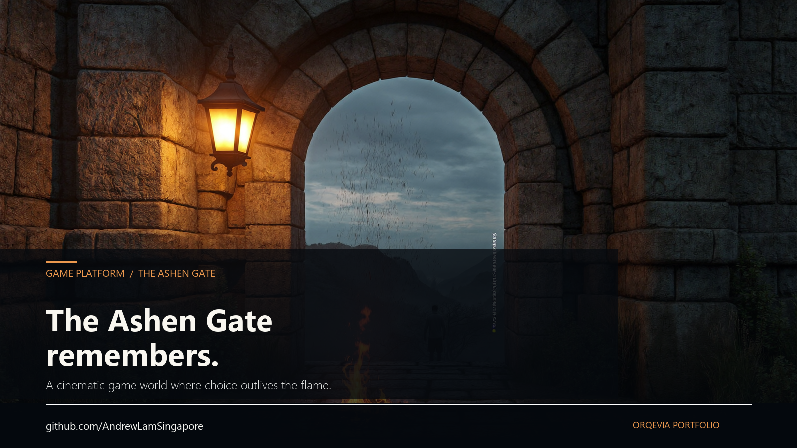

# Game Platform

[**Open Living Worlds ↗**](https://game-platform-wine-nine.vercel.app/) · [**Discuss this project**](https://authority-engine-app.vercel.app/contact?source=game-platform) · [**Meet Andrew Lam**](https://authority-engine-app.vercel.app/about)

An independent working prototype of an AI-assisted persistent role-playing platform. Commercial adoption and outcomes are not asserted.

This product implements Shared Design Language v1 concepts independently. It owns its runtime, database, secrets and deployment. Optional portfolio event exchange and public navigation connect it to the wider work without transferring game authority.

## Connected work

[**Explore ORQEVIA**](https://authority-engine-app.vercel.app/jarvis) · [**Meet Andrew**](https://authority-engine-app.vercel.app/about) · [**Start a conversation**](https://authority-engine-app.vercel.app/contact?source=game-platform&intent=collaboration)

ORQEVIA’s public walkthrough connects this project to Andrew’s wider work. Public navigation and enquiries do not merge accounts, data or runtime authority. Current operational evidence comes from the canonical portfolio record; this README describes source capabilities.

## Product thesis

A persistent AI-native role-playing universe where the world remembers what the player did and consequences propagate through campaign state.

## Architecture

- GM Reasoner: bounded creative/stateful reasoner with deterministic fallback.
- Selective Cinematic Mode: pivotal turns can produce one cached four-second AI video through Vercel AI Gateway, with asynchronous jobs, per-user/campaign limits and text-first fallback.
- Campaign memory: episodic, semantic, decisions, quests and quest graph.
- Living entities: player-owned PCs, autonomous NPCs, factions and items.
- Game Systems v2: multiplayer roles/invites, world clock, rulesets, inventory/equipment, health and deterministic combat.
- Competitive AI primitives: tested deterministic FSM, telemetry, Elo/ranking and risk libraries plus database contracts. Reachable match execution, matchmaking and asynchronous rating/risk workers are not yet demonstrated by this application.
- Competitive integration contract: Living Characters and the Game Master must remain outside any future authoritative competitive hot path.
- Stable Spine: Action Envelope -> classification -> policy -> execution -> verification -> audit.
- Policy states: AUTO, BOUNDED_AUTO, GATED, PROHIBITED.
- Consequential external actions remain gated.
- Dedicated Supabase project with campaign isolation, RLS, server-authoritative game actions and JWT-enforced Edge Functions.
- Temporary public guest preview uses Supabase anonymous identities: no email/password login, while each guest remains isolated by `auth.uid()` ownership and membership policies.

## Infrastructure

Dedicated Supabase project: `vtrfgckzpjgtmqsnumur` (Singapore).

Production web application: `game-platform-wine-nine.vercel.app`.
Production deployment source: `main`.

The repository intentionally contains no service-role keys or private secrets.

## Current release

**Game Systems v2 — temporary public guest preview.** Visitors enter with an isolated anonymous identity and can create private campaigns without an email/password login. Guest continuity is browser-bound; clearing browser storage or changing devices can remove access. The temporary mode intentionally produces Supabase anonymous-access advisor warnings, while ownership and campaign-membership predicates remain enforced.

## Status and evidence

> Portfolio status: [STATUS.md](https://github.com/AndrewLamSingapore/orqevia/blob/main/STATUS.md) is the sole portfolio status reference. Each product owns its source, configuration, contracts and domain records. The [operational manifest](https://github.com/AndrewLamSingapore/orqevia/blob/main/governance/operational-manifest.json) provides dated ORQEVIA component and observation references; it does not establish deployment status.

## Reproducible verification and remaining gates

`npm ci && npm test` verifies the local candidate. `npm run test:schema-recovery`
verifies real PostgreSQL/pgvector replay, isolation and dump/restore in a disposable
offline container; see [DATABASE_RECOVERY.md](docs/DATABASE_RECOVERY.md) for the
pinned image and historical migration collision. It does not deploy services or
repair production migration history.

The [21 October engineering audit](docs/SOVEREIGNTY_AUDIT_20261021.md) classifies
this product as **PARTIALLY COMPLETE**. Candidate credential, schema recovery and
optional-relay repairs passed local tests. Actual deployed guest gameplay,
production recovery and the competitive integrations remain separate unpassed
gates. The production health endpoint checks configuration only.

Independent empty database commissioning uses the deterministic staged CLI path in [FRESH_INSTALL.md](docs/FRESH_INSTALL.md). Existing installations retain their original ledger; no production reset or history rewrite is required.

## Campaign visual

Repository advertising creative, generated through the bounded Higgsfield
campaign (batch 2026-10-22, zero retries, under the US$0.03 cap):

